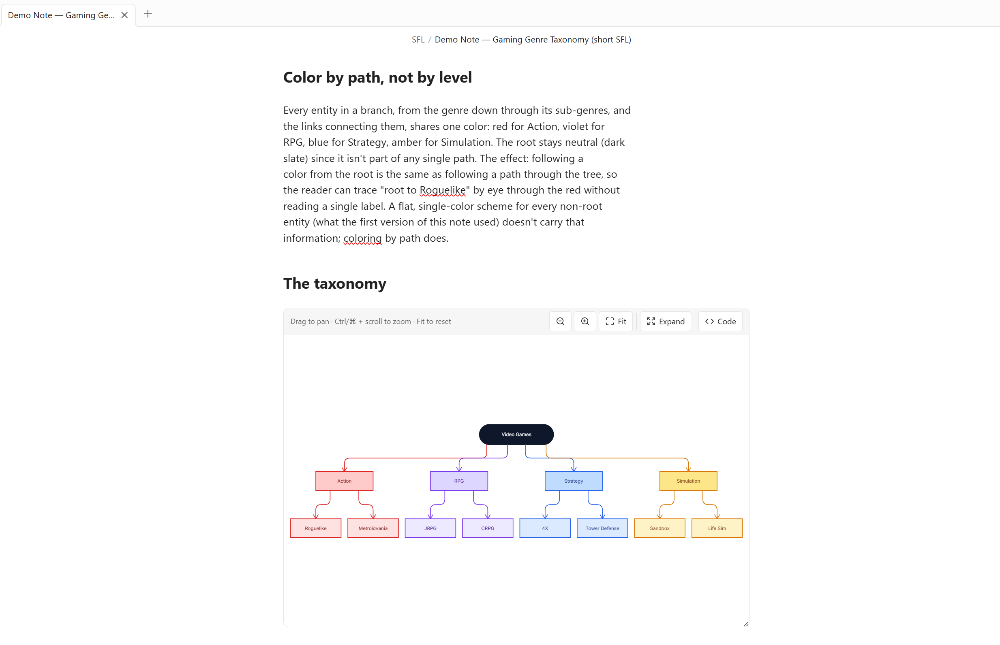

<p align="center">
  
</p>

<div align="center">

# obsidian-sfl

**An Obsidian community plugin for rendering diagrams in your notes.**

</div>

Perfect for learning notes and visualizing concepts across all kinds of
domains: software engineering, mathematics, gaming taxonomies, and more.
Fenced ` ```sfl ` code blocks render as live, interactive diagrams inside
your notes, using [`stickyflow.js`](../stickyflow.js) (SFL 1.4).

## Why obsidian-sfl?

A diagram usually lives outside your notes: a separate whiteboard tab, a
pasted screenshot, an embedded image that goes stale the moment the idea
changes. An SFL diagram is just text, so it stays inside the note itself. It
moves, renames, and version-controls with the note, and it never drifts out
of sync with what you meant, since there's no separate copy to drift.

That fits how notes actually get used for thinking and learning: turning a
new concept into a picture instead of a wall of prose, mapping out a system
before writing about it, or keeping a precise diagram next to the
explanation it belongs to. Software engineering architecture, mathematical
structures, gaming taxonomies: anything you'd otherwise sketch on a
whiteboard works just as well typed directly into the note.

<p align="center">
  
</p>

## Installation

1. Build the plugin (see [Build](#build)) to produce `manifest.json`,
   `main.js` and `styles.css`.
2. Copy those three files into your vault, in a folder named after the
   plugin:
   ```bash
   mkdir -p "<vault>/.obsidian/plugins/obsidian-sfl"
   cp manifest.json main.js styles.css "<vault>/.obsidian/plugins/obsidian-sfl/"
   ```
3. In Obsidian, open **Settings → Community plugins**. Turn off
   **Restricted mode** if this is your first community plugin.
4. Find **SFL Preview** under your installed plugins and enable it (may
   need a restart the first time a plugin is dropped in manually).

A note with a fenced ` ```sfl ` block should now render as an interactive
diagram.

On desktop, each block is a **live viewer** with a **header bar** of controls —
drag anywhere on the canvas to pan, wheel (or the `−` / `+` / `Fit` buttons) to
zoom, click a shape or link to select it (the header shows what's selected). With
the canvas focused (click it, or Tab to a shape) the **keyboard** drives the
camera too: `+` / `-` zoom, `0` fit, arrow keys pan (Shift = bigger step), `Esc`
clears the selection. The block has a `resize: vertical` handle on its bottom
edge; while you haven't panned or zoomed by hand, resizing refits the diagram
automatically (`Fit` re-arms that).

The header **Code** button flips the block between the diagram and its SFL
source; a dot on the button marks unsaved edits parked in the Code view.

The header **Expand** button opens the diagram in a near-fullscreen modal for
a closer look: the same pan, wheel-zoom and click-to-select as the block, plus
its own zoom-out/zoom-in/Fit toolbar, but no Code view and no write-back. It's
a snapshot of what's currently rendered, so further edits to the block aren't
reflected until you reopen it.

- **Editing mode (Live Preview):** an editable textarea, with `Show preview`
  splitting in a live render of your draft above it — type and it updates as you
  go, nothing written to the note. **Click a shape in the preview** and the
  textarea scrolls to and selects that entity's lines. `Save` (or
  `Ctrl`/`⌘`+`Enter`) commits the draft into the fenced block through the note's
  editor (one step on the undo stack, caret preserved across the re-render);
  `Revert` drops it. An unparseable draft holds the last good render and shows
  the (wrapping) error above the footer; `Save` stays disabled until it parses.
  The preview starts collapsed.
- **Reading mode:** the source is shown read-only.

Dragging shapes on the canvas still doesn't edit anything: gesture editing
(move/resize/text via `stickyflow/interaction`) is a later milestone.

> The `stickyflow/viewer` tier itself only pans on ctrl/⌘ + drag (a plain drag
> is left for a host page to scroll); the plugin bridges plain-drag-to-pan on
> top of it (`bindCanvasNav` in `src/main.ts`) since inside a fixed-height block
> that's what a reader expects.

On **mobile**, and in **export / print / PDF**, it falls back to the static
tier (`render(sfl) → svg`) — the viewer needs a live, sized DOM, and drag-pan
would fight the note's touch-scroll on a phone.

## Build

```bash
cd ../stickyflow.js && npm run build   # build the core library first
cd ../obsidian-sfl && npm install && npm run build
```

`npm run build` typechecks (`tsc -noEmit`) then bundles `src/main.ts` (+ the
`stickyflow` dependency) into a single `main.js` via esbuild.

**Rebuild whatever changed, in order.** This package pulls in
`stickyflow.js/dist` at bundle time, not at import time: `npm run build`
here does *not* notice if `stickyflow.js/src` changed since its last build.
Always `npm run build` in `stickyflow.js` first.

Obsidian doesn't hot-reload plugins: after rebuilding, re-copy `main.js` into
the vault's plugin folder and run **Developer: Reload app without saving**
(Ctrl/Cmd+P) or restart.
