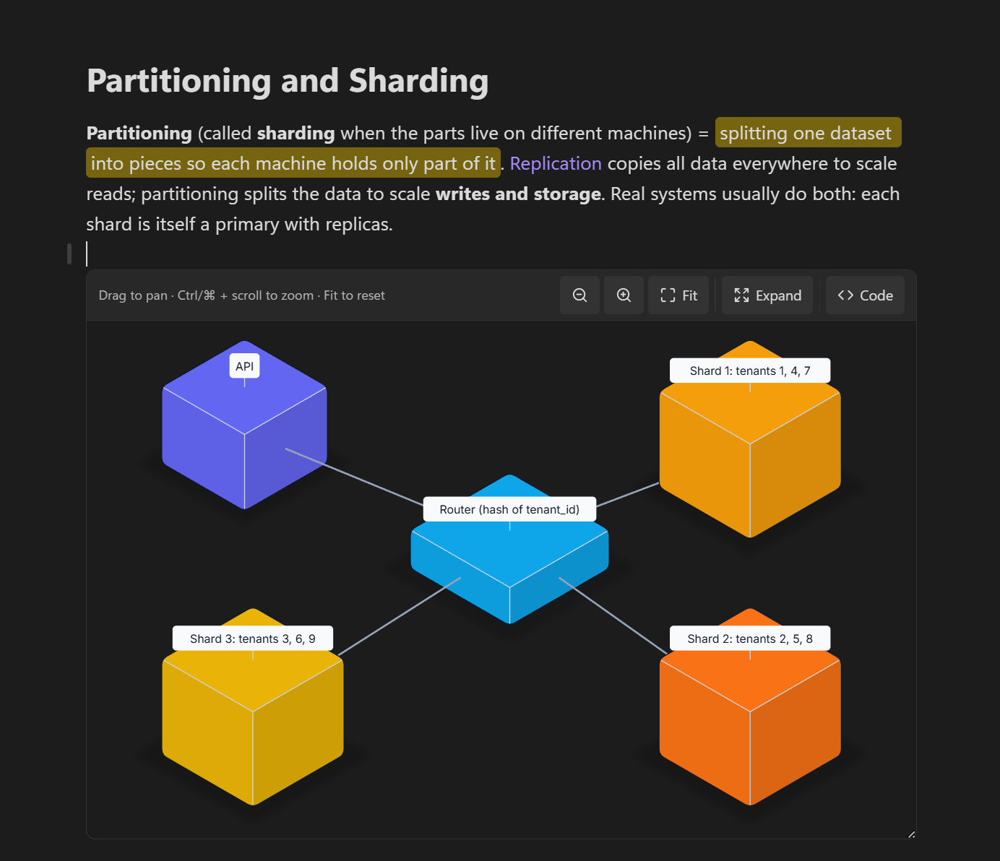

<p align="center">
  <picture>
    <source media="(prefers-color-scheme: dark)" srcset="assets/banner-dark.png">
    
  </picture>
</p>

<div align="center">

# Stickyflow for Obsidian

**An Obsidian community plugin for rendering diagrams in your notes.**

</div>

Perfect for learning notes and visualizing concepts across all kinds of
domains: software engineering, mathematics, gaming taxonomies, and more.
Fenced ` ```sfl ` code blocks render as live, interactive diagrams inside
your notes, using [`stickyflow.js`](https://github.com/Stickyflow/stickyflow.js) (SFL 1.4).

## Why Stickyflow?

A diagram usually lives outside your notes: a separate whiteboard tab, a
pasted screenshot, an embedded image that goes stale the moment the idea
changes. An SFL diagram is just text, so it stays inside the note itself. It
moves, renames, and version-controls with the note, and it never drifts out
of sync with what you meant, since there's no separate copy to drift.

That fits how notes actually get used for thinking and learning: turning a
new concept into a picture instead of a wall of prose, mapping out a system
before writing about it, or keeping a precise diagram next to the
explanation it belongs to. Software engineering architecture, mathematical
structures, gaming taxonomies: anything you'd otherwise sketch on a
whiteboard works just as well typed directly into the note.

<p align="center">
  
</p>

## Installation

### From Community plugins

1. In Obsidian, open **Settings → Community plugins**. Turn off
   **Restricted mode** if this is your first community plugin.
2. Select **Browse**, search for **Stickyflow**, then **Install** and
   **Enable**.

### Manually

1. Download `main.js`, `manifest.json` and `styles.css` from the
   [latest release](https://github.com/Stickyflow/obsidian-sfl/releases/latest),
   or build them yourself (see [Build](#build)).
2. Copy those three files into your vault, in a folder named after the
   plugin id, `stickyflow`:
   ```bash
   mkdir -p "<vault>/.obsidian/plugins/stickyflow"
   cp manifest.json main.js styles.css "<vault>/.obsidian/plugins/stickyflow/"
   ```
3. In Obsidian, open **Settings → Community plugins**. Turn off
   **Restricted mode** if this is your first community plugin.
4. Find **Stickyflow** under your installed plugins and enable it (may
   need a restart the first time a plugin is dropped in manually).

A note with a fenced ` ```sfl ` block should now render as an interactive
diagram.

On desktop, each block is a **live viewer** with a **header bar** of controls —
drag anywhere on the canvas to pan, wheel (or the `−` / `+` / `Fit` buttons) to
zoom, click a shape or link to select it (the header shows what's selected). With
the canvas focused (click it, or Tab to a shape) the **keyboard** drives the
camera too: `+` / `-` zoom, `0` fit, arrow keys pan (Shift = bigger step), `Esc`
clears the selection. The block has a `resize: vertical` handle on its bottom
edge; while you haven't panned or zoomed by hand, resizing refits the diagram
automatically (`Fit` re-arms that).

The header **Code** button flips the block between the diagram and its SFL
source; a dot on the button marks unsaved edits parked in the Code view.

The header **Expand** button opens the diagram in a near-fullscreen modal for
a closer look: the same pan, wheel-zoom and click-to-select as the block, plus
its own zoom-out/zoom-in/Fit toolbar, but no Code view and no write-back. It's
a snapshot of what's currently rendered, so further edits to the block aren't
reflected until you reopen it.

- **Editing mode (Live Preview):** an editable textarea, with `Show preview`
  splitting in a live render of your draft above it — type and it updates as you
  go, nothing written to the note. **Click a shape in the preview** and the
  textarea scrolls to and selects that entity's lines. `Save` (or
  `Ctrl`/`⌘`+`Enter`) commits the draft into the fenced block through the note's
  editor (one step on the undo stack, caret preserved across the re-render);
  `Revert` drops it. An unparseable draft holds the last good render and shows
  the (wrapping) error above the footer; `Save` stays disabled until it parses.
  The preview starts collapsed.
- **Reading mode:** the source is shown read-only.

Dragging shapes on the canvas still doesn't edit anything: gesture editing
(move/resize/text via `stickyflow/interaction`) is a later milestone.

> The `stickyflow/viewer` tier itself only pans on ctrl/⌘ + drag (a plain drag
> is left for a host page to scroll); the plugin bridges plain-drag-to-pan on
> top of it (`bindCanvasNav` in `src/main.ts`) since inside a fixed-height block
> that's what a reader expects.

On **mobile**, and in **export / print / PDF**, it falls back to the static
tier (`render(sfl) → svg`) — the viewer needs a live, sized DOM, and drag-pan
would fight the note's touch-scroll on a phone.

## Example workflow: working with an LLM

An SFL diagram is just text, so any LLM that can write into your vault can
generate one directly into a note the same way it writes any other text: no
export step, nothing specific to this plugin on the LLM's side.

Getting an LLM read/write access to your vault at all needs a one-time setup
this plugin has nothing to do with: install the [Local REST
API](https://github.com/coddingtonbear/obsidian-local-rest-api) community
plugin (Settings → Community plugins → Browse → search "Local REST API"),
copy the API key from its settings, and point your LLM client at the MCP
server it exposes (`https://127.0.0.1:27124/mcp/`, plain HTTP on `27123` to
skip the local cert) with that key as a bearer token. It's a standard MCP
server, so this works the same way for Claude (Claude Desktop, Claude Code),
Cursor, or any other MCP-compatible client: point the client's MCP config at
the URL, not something specific to one of them.

Once that's wired up:

1. Ask the LLM to write a note about a topic and include a diagram: a
   process, a system architecture, a taxonomy. It writes the SFL source
   into a fenced ` ```sfl ` code block, the same as it would write any
   other markdown.
2. Open the note in Obsidian. This plugin renders the block immediately as
   a live, interactive diagram, no round-trip back to the LLM needed just
   to see it.
3. From there it's yours: pan, zoom, click a shape to jump to its source
   in the Code view, or edit the SFL directly and watch the live preview
   update as you type. `Save` writes your changes back into the note.
4. The round trip closes the other way too: ask the LLM questions about the
   note, or ask it to change the diagram, and through the same MCP server
   it reads the note back and can answer from, or rewrite, the SFL source
   itself, not a picture of it, then this plugin renders whatever it wrote.

## Build

```bash
cd ../stickyflow.js && npm run build   # build the core library first
cd ../obsidian-sfl && npm install && npm run build
```

`npm run build` typechecks (`tsc -noEmit`) then bundles `src/main.ts` (+ the
`stickyflow` dependency) into a single `main.js` via esbuild.

**Rebuild whatever changed, in order.** This package pulls in
`stickyflow.js/dist` at bundle time, not at import time: `npm run build`
here does *not* notice if `stickyflow.js/src` changed since its last build.
Always `npm run build` in `stickyflow.js` first.

Obsidian doesn't hot-reload plugins: after rebuilding, re-copy `main.js` into
the vault's plugin folder and run **Developer: Reload app without saving**
(Ctrl/Cmd+P) or restart.

## Releasing

1. Bump `version` in `manifest.json` and `package.json`, and add the new
   version with its `minAppVersion` to `versions.json`.
2. Run `npm run build` and commit.
3. Create a GitHub release whose tag equals the version exactly, with no
   `v` prefix, and attach `main.js`, `manifest.json` and `styles.css`:
   `gh release create 1.0.0 main.js manifest.json styles.css`.

## 🙌 Contributing

This plugin is small on purpose, which makes it a good place to start if
you want to scratch your own itch. Two goals behind that:

- 🌱 **Grow it.** Canvas-gesture editing (dragging, resizing, `+ Entity` /
  `+ Link`), richer mobile support, whatever's missing for your workflow:
  PRs are welcome.
- 🛠️ **Make it yours.** Fork it and bend it toward your own notes: a custom
  color scheme, a different default layout, a shortcut you keep reaching
  for. It's a small enough codebase, one `src/main.ts` plus the
  `stickyflow.js` dependency, that a focused change doesn't require
  understanding the whole thing first.

See [Build](#build) to get set up. Found a bug or have an idea? Open an
issue, or send a PR: small and focused beats big and perfect. We will review, make comments if necessary, and merge if we are happy with the result. 🚀

## License

[Apache License 2.0](LICENSE)
