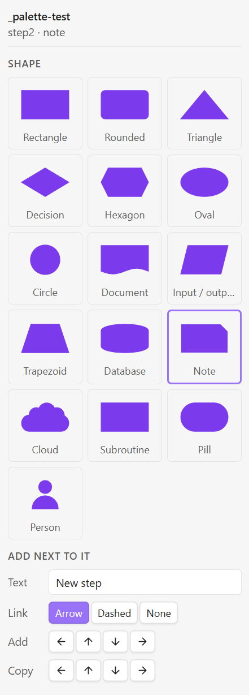
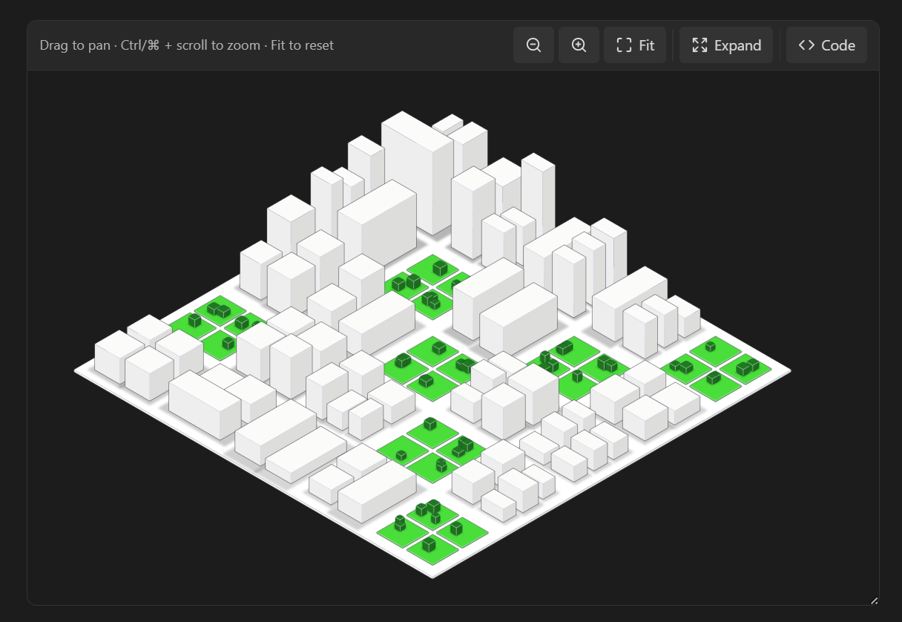

<p align="center">
  <picture>
    <source media="(prefers-color-scheme: dark)" srcset="assets/banner-dark.png">
    
  </picture>
</p>

<div align="center">

# Stickyflow for Obsidian

**An Obsidian community plugin for rendering diagrams in your notes.**

[Install from Obsidian's community plugins](https://community.obsidian.md/plugins/stickyflow)

</div>

Perfect for learning notes and visualizing concepts across all kinds of
domains: software engineering, mathematics, gaming taxonomies, and more.
Fenced ` ```sfl ` code blocks render as live, interactive diagrams inside
your notes, using [`stickyflow.js`](https://github.com/Stickyflow/stickyflow.js) (SFL 1.4).

To learn more about Stickyflow and the SFL diagram language, visit
[stickyflow.org](https://stickyflow.org/).

## Why Stickyflow?

A diagram usually lives outside your notes: a separate whiteboard tab, a
pasted screenshot, an embedded image that goes stale the moment the idea
changes. An SFL diagram is just text, so it stays inside the note itself. It
moves, renames, and version-controls with the note, and it never drifts out
of sync with what you meant, since there's no separate copy to drift.

That fits how notes actually get used for thinking and learning: turning a
new concept into a picture instead of a wall of prose, mapping out a system
before writing about it, or keeping a precise diagram next to the
explanation it belongs to. Software engineering architecture, mathematical
structures, gaming taxonomies: anything you'd otherwise sketch on a
whiteboard works just as well typed directly into the note.

<p align="center">
  
</p>

## Installation

### From Community plugins

Stickyflow is listed in Obsidian's
[community plugin directory](https://community.obsidian.md/plugins/stickyflow).

1. In Obsidian, open **Settings → Community plugins**. Turn off
   **Restricted mode** if this is your first community plugin.
2. Select **Browse**, search for **Stickyflow**, then **Install** and
   **Enable**.

Updates arrive the same way: **Settings → Community plugins → Check for
updates**.

### Manually

To pin a specific version or try a build of your own:

1. Download `main.js`, `manifest.json` and `styles.css` from the
   [latest release](https://github.com/Stickyflow/obsidian-sfl/releases/latest),
   or build them yourself (see [Build](#build)).
2. Copy those three files into your vault, in a folder named after the
   plugin id, `stickyflow`:
   ```bash
   mkdir -p "<vault>/.obsidian/plugins/stickyflow"
   cp manifest.json main.js styles.css "<vault>/.obsidian/plugins/stickyflow/"
   ```
3. In Obsidian, open **Settings → Community plugins**. Turn off
   **Restricted mode** if this is your first community plugin.
4. Find **Stickyflow** under your installed plugins and enable it (may
   need a restart the first time a plugin is dropped in manually).

A note with a fenced ` ```sfl ` block should now render as an interactive
diagram.

On desktop, each block is a **live viewer** with a **header bar** of controls —
drag anywhere on the canvas to pan, wheel (or the `−` / `+` / `Fit` buttons) to
zoom, click a shape or link to select it (the header shows what's selected). With
the canvas focused (click it, or Tab to a shape) the **keyboard** drives the
camera too: `+` / `-` zoom, `0` fit, arrow keys pan (Shift = bigger step), `Esc`
clears the selection. The block has a `resize: vertical` handle on its bottom
edge; while you haven't panned or zoomed by hand, resizing refits the diagram
automatically (`Fit` re-arms that).

The header **Code** button flips the block between the diagram and its SFL
source; a dot on the button marks unsaved edits parked in the Code view. The
source is syntax highlighted in both modes, using your theme's code colors.

The header **Expand** button opens the diagram in a near-fullscreen modal for
a closer look: the same pan, wheel-zoom and click-to-select as the block, plus
its own zoom-out/zoom-in/Fit toolbar, but no Code view and no write-back. It's
a snapshot of what's currently rendered, so further edits to the block aren't
reflected until you reopen it.

- **Editing mode (Live Preview):** an editable textarea, with `Show preview`
  splitting in a live render of your draft above it — type and it updates as you
  go, nothing written to the note. **Click a shape in the preview** and the
  textarea scrolls to and selects that entity's lines. `Save` (or
  `Ctrl`/`⌘`+`Enter`) commits the draft into the fenced block through the note's
  editor (one step on the undo stack, caret preserved across the re-render);
  `Revert` drops it. An unparseable draft holds the last good render and shows
  the (wrapping) error above the footer; `Save` stays disabled until it parses.
  The preview starts collapsed.
- **Reading mode:** the source is shown read-only.

### SFL palette

The **SFL palette** is a side panel for changing a diagram by clicking instead
of typing SFL. Select something in a diagram and the palette shows what you
can do with it: turn a shape into another one, add a linked shape next to it,
copy it, or restyle a link. Everything it does is written back into the SFL
text of the block, so the note stays plain text you can still edit by hand.

<p align="center">
  
</p>

Open it with the header **palette** button, the `Open SFL palette` command or
the ribbon icon. It opens in the right sidebar and follows the last block you
selected something in, in a note open in editing mode:

- **One shape selected:** click a shape tile to change *that* shape (only
  `shape:` is overridden, and dropped again when its Style already has the
  one you pick); the tiles are rendered from the note's own Style blocks.
  Below them, `Add` (left / above / below / right) puts a linked shape of the
  same kind one gap away, with the text and link type (arrow, dashed, none)
  set above it, and selects it, so repeated clicks build a chain; `Copy` does
  the same with a full copy of the shape, unlinked.
- **One link selected:** switch it between `Solid` and `Dashed`.
- **Two shapes selected** (Shift/Ctrl-click the second): add an arrow or a
  dashed arrow between them, on the faces that point at each other.

Every change is validated before it's written. With no pending draft it goes
straight into the note (one undo step); with unsaved edits in the Code view it
goes into that draft instead, for you to Save or Revert. New shapes are placed
next to the selected one, not around everything else, so they can overlap an
existing shape.

### Canvas editing

In a note open in **editing mode** the canvas itself is editable too (via
`stickyflow/interaction`): drag a shape to move it, drag its handles to
resize, drag a link's end or segment, double-click to edit text, `Delete` to
remove (a shape takes its links with it), arrow keys to nudge the selection
(Shift = 10), click a `+` bubble to add a linked neighbour of the same shape or
drag it onto another shape to link the two. Each gesture is one undo step and
goes where the palette's edits go (the note, or a pending Code view draft).
Plain drag on empty canvas still pans. In Reading mode and the Expand modal the
canvas is view-only and shows just the selection outline.

> The `stickyflow/viewer` tier itself only pans on ctrl/⌘ + drag (a plain drag
> is left for a host page to scroll); the plugin bridges plain-drag-to-pan on
> top of it (`bindCanvasNav` in `src/main.ts`) since inside a fixed-height block
> that's what a reader expects.

On **mobile**, and in **export / print / PDF**, it falls back to the static
tier (`render(sfl) → svg`) — the viewer needs a live, sized DOM, and drag-pan
would fight the note's touch-scroll on a phone.

## Example: an urban planning district

A 5 × 5 block city district in the look of an architectural massing model:
white building volumes, white streets, and green parks with trees. Every
object is an `Isometric` box, where `size: W, H, D` is footprint width,
height and footprint depth, and three styles (`Building`, `Grass`, `Tree`)
do all of the look. Objects are listed back to front, because later ones
paint over earlier ones. The source was generated by a small script, which is
why the ids are just `b1`, `g2`, `t3`.

<p align="center">
  
</p>

<details>
<summary>The SFL source</summary>

```sfl
sfl 1.4

Style Building {
  fill: "#fbfbfa"
  stroke: "#3f3f46"
  cornerRadius: 1
  shadow: "shadow(opacity:0.22, blur:6, x:6, y:4)"
}

Style Grass {
  fill: "#4ade3a"
  stroke: "#3f3f46"
  cornerRadius: 1
}

Style Tree {
  fill: "#1f7a1f"
  stroke: "#14532d"
  cornerRadius: 6
  shadow: "shadow(opacity:0.25, blur:4, x:4, y:3)"
}

Model district {
  Isometric ground { layout { position: -52, -551; size: 1090, 6, 1090 }; style { fill: "#ffffff"; stroke: "#3f3f46"; cornerRadius: 4 } }
  Isometric g1 : Grass { layout { position: 824, -309; size: 79, 3, 79 } }
  Isometric g2 : Grass { layout { position: 745, -263; size: 79, 3, 79 } }
  Isometric g3 : Grass { layout { position: 902, -263; size: 79, 3, 79 } }
  Isometric g4 : Grass { layout { position: 824, -218; size: 79, 3, 79 } }
  Isometric g5 : Grass { layout { position: 265, -201; size: 79, 3, 79 } }
  Isometric g6 : Grass { layout { position: 186, -156; size: 79, 3, 79 } }
  Isometric g7 : Grass { layout { position: 344, -156; size: 79, 3, 79 } }
  Isometric g8 : Grass { layout { position: 265, -110; size: 79, 3, 79 } }
  Isometric g9 : Grass { layout { position: 824, -94; size: 79, 3, 79 } }
  Isometric g10 : Grass { layout { position: 1196, -94; size: 79, 3, 79 } }
  Isometric g11 : Grass { layout { position: 1568, -94; size: 79, 3, 79 } }
  Isometric g12 : Grass { layout { position: 745, -48; size: 79, 3, 79 } }
  Isometric g13 : Grass { layout { position: 902, -48; size: 79, 3, 79 } }
  Isometric g14 : Grass { layout { position: 1117, -48; size: 79, 3, 79 } }
  Isometric g15 : Grass { layout { position: 1275, -48; size: 79, 3, 79 } }
  Isometric g16 : Grass { layout { position: 1490, -48; size: 79, 3, 79 } }
  Isometric g17 : Grass { layout { position: 1647, -48; size: 79, 3, 79 } }
  Isometric g18 : Grass { layout { position: 824, -3; size: 79, 3, 79 } }
  Isometric g19 : Grass { layout { position: 1196, -3; size: 79, 3, 79 } }
  Isometric g20 : Grass { layout { position: 1568, -3; size: 79, 3, 79 } }
  Isometric g21 : Grass { layout { position: 824, 121; size: 79, 3, 79 } }
  Isometric g22 : Grass { layout { position: 745, 167; size: 79, 3, 79 } }
  Isometric g23 : Grass { layout { position: 902, 167; size: 79, 3, 79 } }
  Isometric g24 : Grass { layout { position: 824, 212; size: 79, 3, 79 } }
  Isometric g25 : Grass { layout { position: 824, 336; size: 79, 3, 79 } }
  Isometric g26 : Grass { layout { position: 745, 382; size: 79, 3, 79 } }
  Isometric g27 : Grass { layout { position: 902, 382; size: 79, 3, 79 } }
  Isometric g28 : Grass { layout { position: 824, 427; size: 79, 3, 79 } }
  Isometric b29 : Building { layout { position: 830, -628; size: 43, 110, 72 } }
  Isometric b30 : Building { layout { position: 890, -679; size: 34, 196, 62 } }
  Isometric b31 : Building { layout { position: 930, -659; size: 48, 199, 76 } }
  Isometric b32 : Building { layout { position: 757, -687; size: 156, 219, 64 } }
  Isometric b33 : Building { layout { position: 669, -623; size: 70, 214, 42 } }
  Isometric b34 : Building { layout { position: 1009, -565; size: 78, 152, 80 } }
  Isometric b35 : Building { layout { position: 619, -540; size: 68, 162, 40 } }
  Isometric b36 : Building { layout { position: 1125, -577; size: 66, 216, 38 } }
  Isometric b37 : Building { layout { position: 941, -541; size: 66, 179, 68 } }
  Isometric b38 : Building { layout { position: 571, -541; size: 64, 195, 35 } }
  Isometric b39 : Building { layout { position: 642, -506; size: 74, 141, 166 } }
  Isometric b40 : Building { layout { position: 1071, -434; size: 68, 102, 39 } }
  Isometric b41 : Building { layout { position: 1021, -417; size: 67, 116, 38 } }
  Isometric b42 : Building { layout { position: 456, -467; size: 73, 164, 74 } }
  Isometric t43 : Tree { layout { position: 893, -294; size: 22, 21, 22 } }
  Isometric b44 : Building { layout { position: 1131, -408; size: 63, 110, 155 } }
  Isometric b45 : Building { layout { position: 1308, -406; size: 70, 151, 41 } }
  Isometric t46 : Tree { layout { position: 822, -248; size: 15, 12, 15 } }
  Isometric t47 : Tree { layout { position: 979, -253; size: 18, 17, 18 } }
  Isometric t48 : Tree { layout { position: 824, -259; size: 21, 22, 21 } }
  Isometric b49 : Building { layout { position: 385, -347; size: 64, 94, 65 } }
  Isometric b50 : Building { layout { position: 535, -374; size: 71, 118, 73 } }
  Isometric t51 : Tree { layout { position: 785, -250; size: 20, 19, 20 } }
  Isometric t52 : Tree { layout { position: 942, -244; size: 15, 19, 15 } }
  Isometric t53 : Tree { layout { position: 949, -238; size: 16, 17, 16 } }
  Isometric b54 : Building { layout { position: 1259, -369; size: 65, 146, 37 } }
  Isometric t55 : Tree { layout { position: 875, -212; size: 18, 19, 18 } }
  Isometric t56 : Tree { layout { position: 864, -211; size: 17, 21, 17 } }
  Isometric b57 : Building { layout { position: 457, -315; size: 72, 103, 74 } }
  Isometric t58 : Tree { layout { position: 883, -194; size: 17, 14, 17 } }
  Isometric b59 : Building { layout { position: 1207, -334; size: 65, 141, 37 } }
  Isometric b60 : Building { layout { position: 645, -311; size: 69, 117, 71 } }
  Isometric t61 : Tree { layout { position: 299, -184; size: 21, 15, 21 } }
  Isometric t62 : Tree { layout { position: 324, -177; size: 21, 15, 21 } }
  Isometric b63 : Building { layout { position: 945, -301; size: 62, 111, 154 } }
  Isometric b64 : Building { layout { position: 1312, -279; size: 69, 86, 160 } }
  Isometric t65 : Tree { layout { position: 250, -155; size: 19, 20, 19 } }
  Isometric b66 : Building { layout { position: 1489, -203; size: 76, 52, 48 } }
  Isometric t67 : Tree { layout { position: 372, -149; size: 21, 18, 21 } }
  Isometric b68 : Building { layout { position: 562, -233; size: 74, 82, 76 } }
  Isometric t69 : Tree { layout { position: 417, -135; size: 16, 19, 16 } }
  Isometric b70 : Building { layout { position: 645, -215; size: 70, 67, 162 } }
  Isometric b71 : Building { layout { position: 1016, -235; size: 72, 86, 164 } }
  Isometric b72 : Building { layout { position: 1442, -204; size: 69, 86, 41 } }
  Isometric t73 : Tree { layout { position: 339, -93; size: 18, 18, 18 } }
  Isometric b74 : Building { layout { position: 1393, -179; size: 67, 93, 38 } }
  Isometric t75 : Tree { layout { position: 1610, -81; size: 15, 14, 15 } }
  Isometric t76 : Tree { layout { position: 1230, -84; size: 18, 17, 18 } }
  Isometric b77 : Building { layout { position: 88, -152; size: 70, 66, 68 } }
  Isometric b78 : Building { layout { position: 456, -172; size: 72, 84, 74 } }
  Isometric t79 : Tree { layout { position: 891, -81; size: 21, 16, 21 } }
  Isometric t80 : Tree { layout { position: 1217, -75; size: 16, 13, 16 } }
  Isometric t81 : Tree { layout { position: 1221, -76; size: 16, 17, 16 } }
  Isometric t82 : Tree { layout { position: 1175, -57; size: 15, 22, 15 } }
  Isometric t83 : Tree { layout { position: 797, -51; size: 22, 17, 22 } }
  Isometric t84 : Tree { layout { position: 793, -39; size: 15, 14, 15 } }
  Isometric t85 : Tree { layout { position: 798, -43; size: 15, 18, 15 } }
  Isometric t86 : Tree { layout { position: 1326, -45; size: 20, 22, 20 } }
  Isometric t87 : Tree { layout { position: 953, -36; size: 17, 17, 17 } }
  Isometric t88 : Tree { layout { position: 1718, -36; size: 19, 17, 19 } }
  Isometric b89 : Building { layout { position: 163, -113; size: 74, 70, 72 } }
  Isometric b90 : Building { layout { position: 376, -133; size: 74, 89, 76 } }
  Isometric t91 : Tree { layout { position: 1516, -31; size: 17, 13, 17 } }
  Isometric b92 : Building { layout { position: 3, -111; size: 77, 68, 75 } }
  Isometric b93 : Building { layout { position: 530, -132; size: 78, 87, 80 } }
  Isometric t94 : Tree { layout { position: 968, -35; size: 19, 18, 19 } }
  Isometric t95 : Tree { layout { position: 1194, -35; size: 17, 19, 17 } }
  Isometric t96 : Tree { layout { position: 1347, -33; size: 18, 17, 18 } }
  Isometric t97 : Tree { layout { position: 967, -35; size: 22, 18, 22 } }
  Isometric t98 : Tree { layout { position: 1541, -30; size: 21, 15, 21 } }
  Isometric t99 : Tree { layout { position: 1691, -27; size: 21, 18, 21 } }
  Isometric t100 : Tree { layout { position: 1168, -26; size: 21, 19, 21 } }
  Isometric t101 : Tree { layout { position: 1619, -3; size: 18, 15, 18 } }
  Isometric t102 : Tree { layout { position: 1260, -7; size: 15, 21, 15 } }
  Isometric t103 : Tree { layout { position: 1613, 1; size: 17, 16, 17 } }
  Isometric t104 : Tree { layout { position: 857, 7; size: 14, 13, 14 } }
  Isometric t105 : Tree { layout { position: 856, 5; size: 22, 15, 22 } }
  Isometric b106 : Building { layout { position: 83, -69; size: 75, 72, 73 } }
  Isometric b107 : Building { layout { position: 464, -101; size: 64, 109, 65 } }
  Isometric b108 : Building { layout { position: 1038, -55; size: 74, 74, 46 } }
  Isometric b109 : Building { layout { position: 266, -22; size: 80, 39, 78 } }
  Isometric b110 : Building { layout { position: 647, -57; size: 69, 79, 67 } }
  Isometric b111 : Building { layout { position: 1395, -31; size: 63, 55, 65 } }
  Isometric b112 : Building { layout { position: 992, -33; size: 68, 85, 40 } }
  Isometric b113 : Building { layout { position: 559, -25; size: 50, 88, 78 } }
  Isometric b114 : Building { layout { position: 721, 20; size: 73, 45, 72 } }
  Isometric b115 : Building { layout { position: 344, 7; size: 80, 55, 78 } }
  Isometric b116 : Building { layout { position: 1307, 5; size: 74, 59, 76 } }
  Isometric b117 : Building { layout { position: 1464, 27; size: 75, 37, 77 } }
  Isometric b118 : Building { layout { position: 1090, -24; size: 77, 88, 78 } }
  Isometric b119 : Building { layout { position: 940, 28; size: 69, 53, 41 } }
  Isometric b120 : Building { layout { position: 198, -5; size: 156, 75, 64 } }
  Isometric b121 : Building { layout { position: 614, 47; size: 47, 47, 75 } }
  Isometric b122 : Building { layout { position: 1392, 60; size: 68, 53, 70 } }
  Isometric b123 : Building { layout { position: 1021, 28; size: 66, 86, 67 } }
  Isometric t124 : Tree { layout { position: 869, 118; size: 19, 18, 19 } }
  Isometric b125 : Building { layout { position: 671, 69; size: 39, 59, 67 } }
  Isometric b126 : Building { layout { position: 1233, 73; size: 65, 58, 36 } }
  Isometric b127 : Building { layout { position: 372, 71; size: 78, 53, 170 } }
  Isometric b128 : Building { layout { position: 1178, 104; size: 69, 55, 41 } }
  Isometric t129 : Tree { layout { position: 960, 169; size: 15, 22, 15 } }
  Isometric b130 : Building { layout { position: 1306, 130; size: 72, 43, 44 } }
  Isometric t131 : Tree { layout { position: 968, 174; size: 18, 19, 18 } }
  Isometric b132 : Building { layout { position: 1121, 156; size: 74, 30, 46 } }
  Isometric t133 : Tree { layout { position: 943, 194; size: 20, 12, 20 } }
  Isometric t134 : Tree { layout { position: 796, 205; size: 16, 13, 16 } }
  Isometric b135 : Building { layout { position: 452, 143; size: 78, 28, 169 } }
  Isometric b136 : Building { layout { position: 1256, 152; size: 70, 53, 41 } }
  Isometric t137 : Tree { layout { position: 902, 226; size: 14, 14, 14 } }
  Isometric t138 : Tree { layout { position: 902, 235; size: 16, 14, 16 } }
  Isometric b139 : Building { layout { position: 1204, 194; size: 69, 41, 41 } }
  Isometric b140 : Building { layout { position: 640, 187; size: 75, 46, 77 } }
  Isometric b141 : Building { layout { position: 1019, 177; size: 66, 61, 68 } }
  Isometric b142 : Building { layout { position: 1126, 243; size: 65, 41, 37 } }
  Isometric b143 : Building { layout { position: 567, 243; size: 67, 39, 69 } }
  Isometric b144 : Building { layout { position: 943, 229; size: 64, 55, 66 } }
  Isometric b145 : Building { layout { position: 643, 231; size: 73, 49, 165 } }
  Isometric b146 : Building { layout { position: 1064, 253; size: 76, 56, 47 } }
  Isometric t147 : Tree { layout { position: 878, 334; size: 20, 20, 20 } }
  Isometric b148 : Building { layout { position: 1020, 308; size: 67, 35, 39 } }
  Isometric t149 : Tree { layout { position: 848, 344; size: 17, 20, 17 } }
  Isometric t150 : Tree { layout { position: 888, 369; size: 14, 18, 14 } }
  Isometric t151 : Tree { layout { position: 794, 375; size: 14, 21, 14 } }
  Isometric t152 : Tree { layout { position: 792, 390; size: 17, 13, 17 } }
  Isometric t153 : Tree { layout { position: 939, 392; size: 18, 21, 18 } }
  Isometric t154 : Tree { layout { position: 865, 434; size: 20, 21, 20 } }
}
```

</details>

## Example workflow: working with an LLM

An SFL diagram is just text, so any LLM that can write into your vault can
generate one directly into a note the same way it writes any other text: no
export step, nothing specific to this plugin on the LLM's side.

Getting an LLM read/write access to your vault at all needs a one-time setup
this plugin has nothing to do with: install the [Local REST
API](https://github.com/coddingtonbear/obsidian-local-rest-api) community
plugin (Settings → Community plugins → Browse → search "Local REST API"),
copy the API key from its settings, and point your LLM client at the MCP
server it exposes (`https://127.0.0.1:27124/mcp/`, plain HTTP on `27123` to
skip the local cert) with that key as a bearer token. It's a standard MCP
server, so this works the same way for Claude (Claude Desktop, Claude Code),
Cursor, or any other MCP-compatible client: point the client's MCP config at
the URL, not something specific to one of them.

Once that's wired up:

1. Ask the LLM to write a note about a topic and include a diagram: a
   process, a system architecture, a taxonomy. It writes the SFL source
   into a fenced ` ```sfl ` code block, the same as it would write any
   other markdown.
2. Open the note in Obsidian. This plugin renders the block immediately as
   a live, interactive diagram, no round-trip back to the LLM needed just
   to see it.
3. From there it's yours: pan, zoom, click a shape to jump to its source
   in the Code view, or edit the SFL directly and watch the live preview
   update as you type. `Save` writes your changes back into the note.
4. The round trip closes the other way too: ask the LLM questions about the
   note, or ask it to change the diagram, and through the same MCP server
   it reads the note back and can answer from, or rewrite, the SFL source
   itself, not a picture of it, then this plugin renders whatever it wrote.

## Build

```bash
npm install && npm run build
```

`npm run build` typechecks (`tsc -noEmit`) then bundles `src/main.ts` (+ the
[`stickyflow`](https://www.npmjs.com/package/stickyflow) package from npm)
into a single `main.js` via esbuild.

To try local changes to stickyflow.js, build it and point the dependency at
your checkout with `npm install ../stickyflow.js`, but don't commit that:
releases must build from the published npm package.

Obsidian doesn't hot-reload plugins: after rebuilding, re-copy `main.js` into
the vault's plugin folder and run **Developer: Reload app without saving**
(Ctrl/Cmd+P) or restart.

## Releasing

1. Bump `version` in `manifest.json` and `package.json`, and add the new
   version with its `minAppVersion` to `versions.json`.
2. Run `npm run build` and commit.
3. Create a GitHub release whose tag equals the version exactly, with no
   `v` prefix, and attach `main.js`, `manifest.json` and `styles.css`:
   `gh release create 1.0.0 main.js manifest.json styles.css`.

## 🙌 Contributing

This plugin is small on purpose, which makes it a good place to start if
you want to scratch your own itch. Two goals behind that:

- 🌱 **Grow it.** Canvas-gesture editing (dragging, resizing, `+ Entity` /
  `+ Link`), richer mobile support, whatever's missing for your workflow:
  PRs are welcome.
- 🛠️ **Make it yours.** Fork it and bend it toward your own notes: a custom
  color scheme, a different default layout, a shortcut you keep reaching
  for. It's a small enough codebase, one `src/main.ts` plus the
  `stickyflow.js` dependency, that a focused change doesn't require
  understanding the whole thing first.

See [Build](#build) to get set up. Found a bug or have an idea? Open an
issue, or send a PR: small and focused beats big and perfect. We will review, make comments if necessary, and merge if we are happy with the result. 🚀

## License

[Apache License 2.0](LICENSE)
